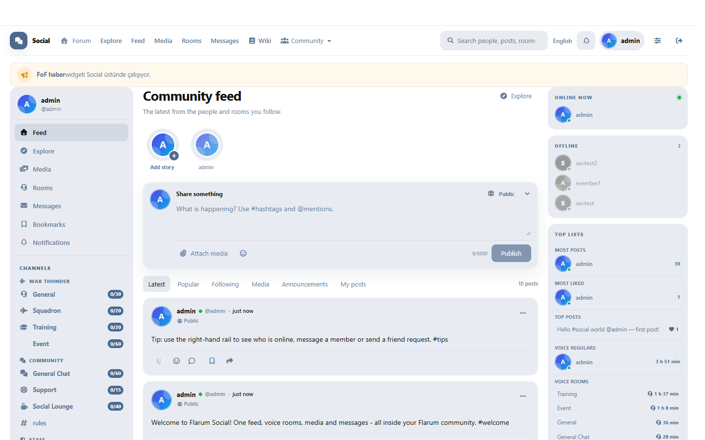
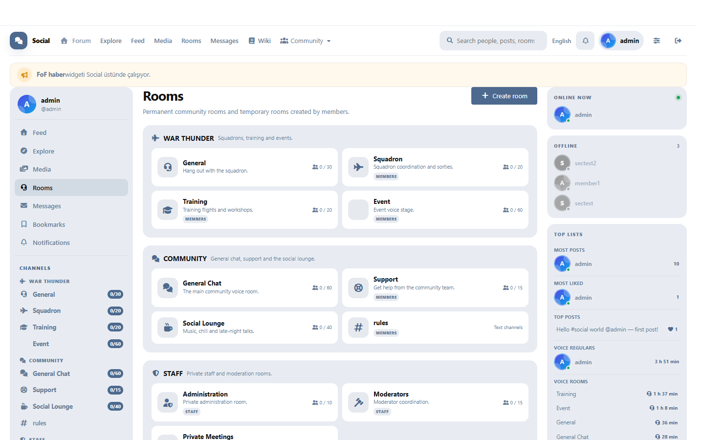
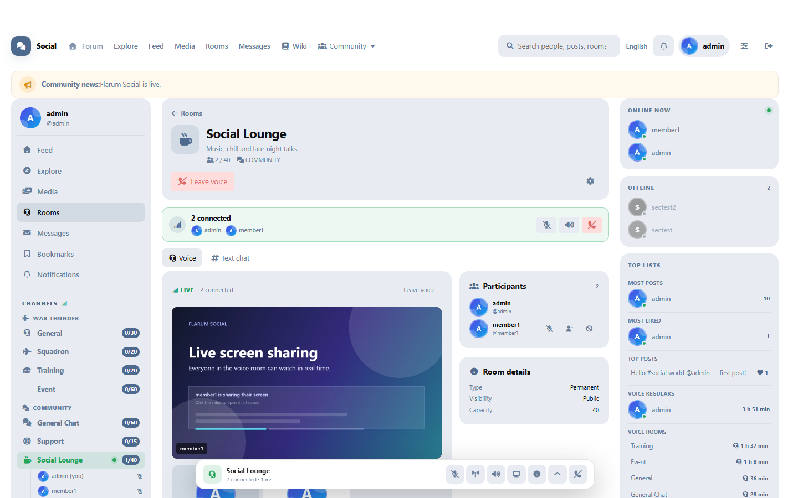
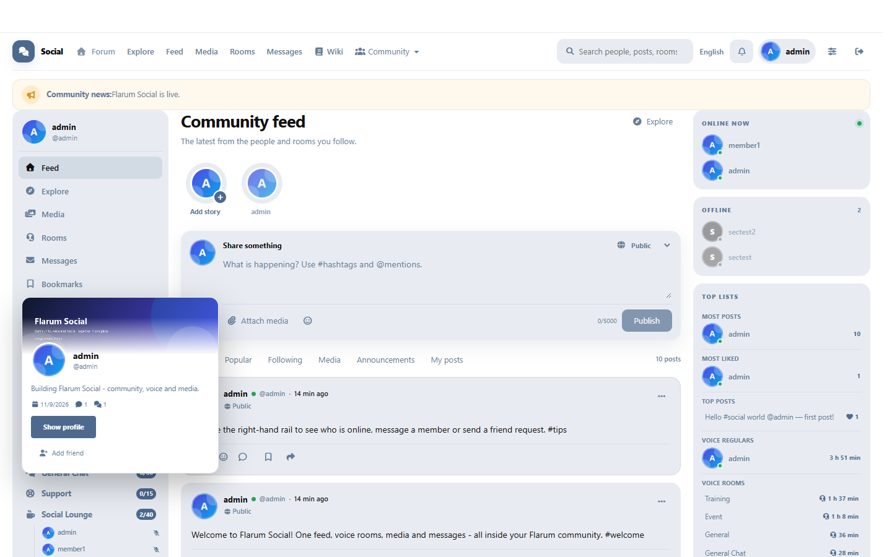
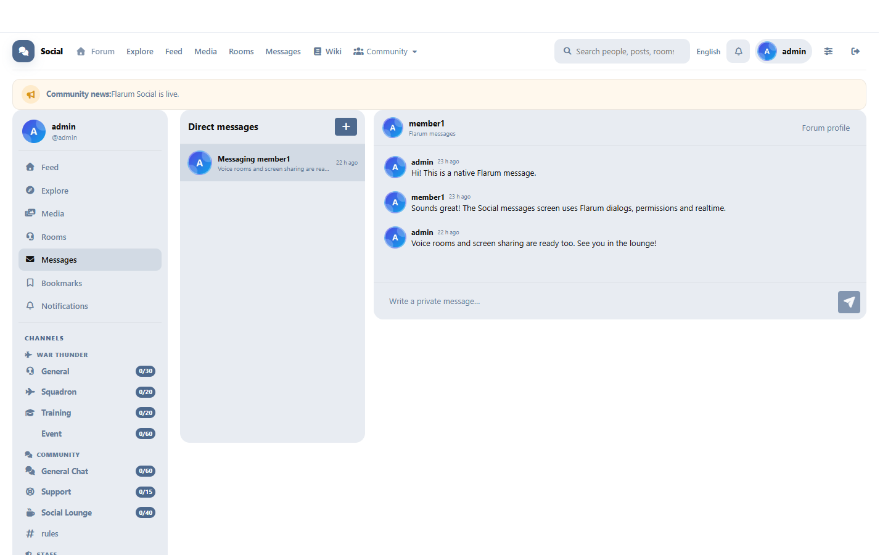
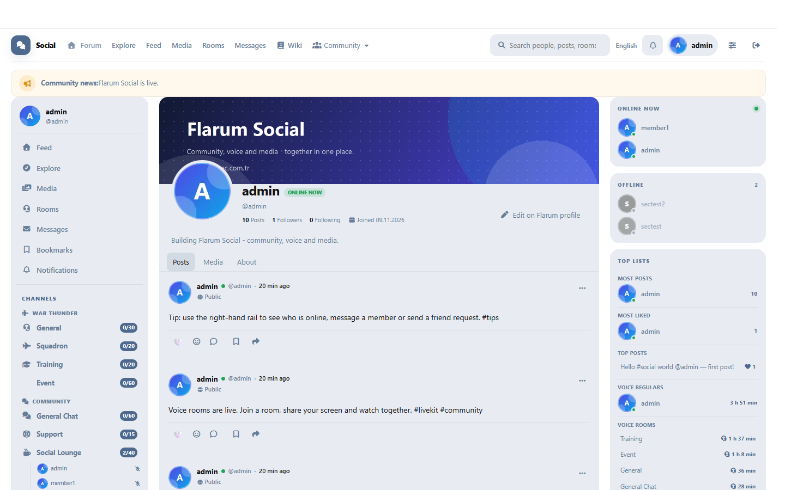
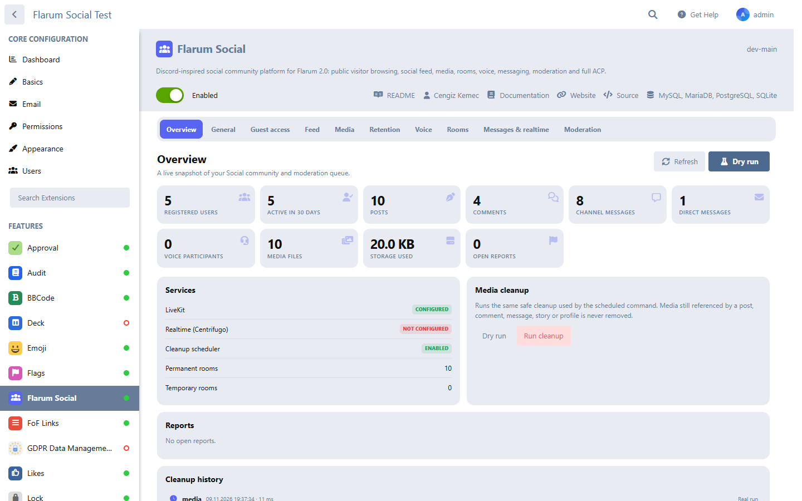
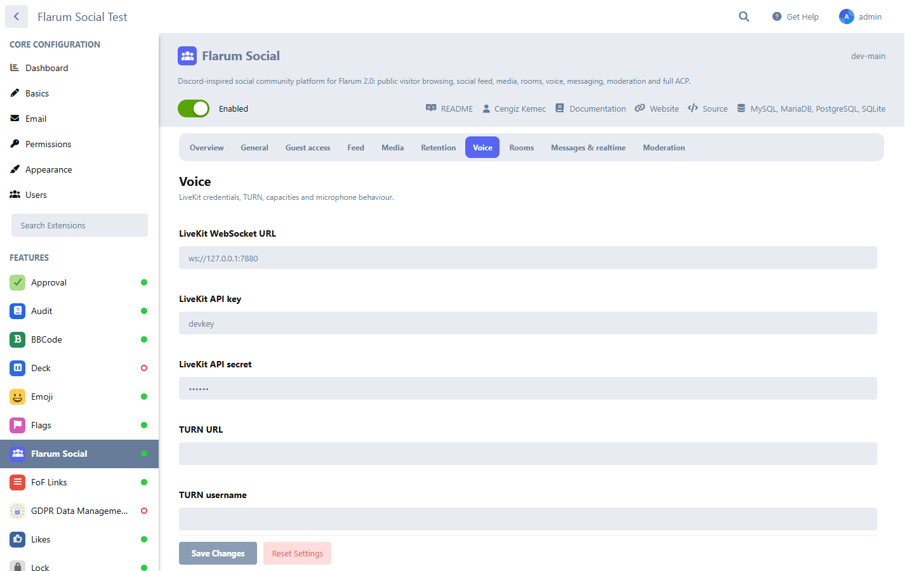
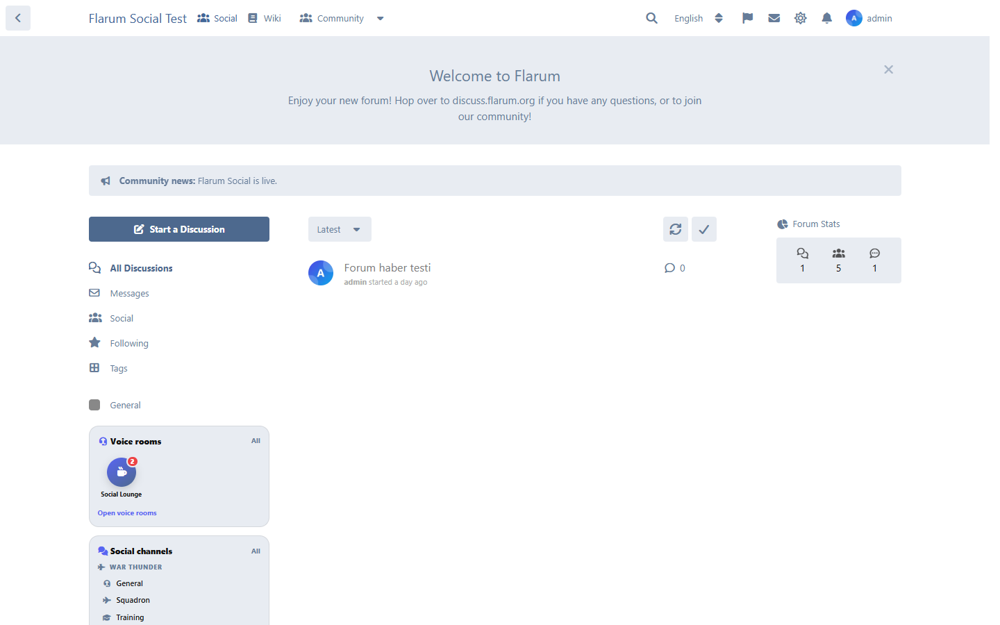
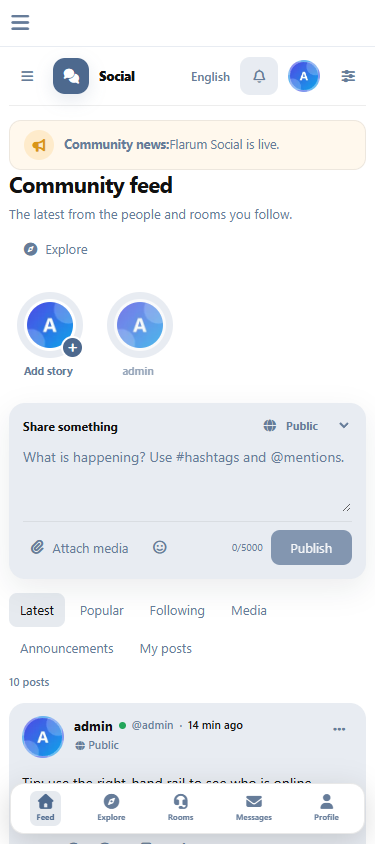

# Flarum Social

Flarum Social is a Flarum 2.0 extension that adds a Discord-inspired community layer on top of Flarum: a public social feed, media, profiles, rooms, text channels, direct messages, LiveKit voice rooms, moderation and a complete admin panel.

It is a native Flarum extension. It uses Flarum users, sessions, permissions, translations, the s9e text formatter and the Flarum SPA router. No core files are modified.

## Features

- Public feed, post pages, comments, reactions, bookmarks, stories, media and hashtags.
- Slug URLs for rooms, for example `/social/rooms/general-chat`, with legacy numeric URLs still accepted.
- Discord-style left navigation with permanent voice rooms, live participant rows and participant counts.
- Voice rooms with LiveKit: join from the sidebar, persistent voice panel while browsing, mute/deafen, push-to-talk, screen sharing, per-member volume and Discord-style sound cues.
- Chat-first voice rooms: joining a voice room opens that room's own text chat while the voice connection starts in the background.
- Member-created temporary rooms that are deleted ten seconds after the last participant leaves. Permanent rooms stay online and show their live participant count.
- Text channels, direct messages, notifications, follows/friends and reports.
- Drag-and-drop, multi-file and clipboard-image uploads in text channels.
- Discord-style shareable room invite links with expiry and maximum uses.
- Social Statistics, configurable right-rail widget ordering and optional forum-sidebar channel menus.
- Flarum forum categories shown inside the Social menu, with an ACP toggle.
- Native `flarum/messages` integration: Social renders Flarum dialogs and message threads inside its own layout.
- Optional `flarum/audit` integration for posts, comments, rooms, media, reports, profiles, stories, messages and moderation actions.
- Profile customization stays in Flarum: Social reads the same bio, cover, avatar and display name.
- FoF Links compatibility in the Social header, with link groups and visibility rules.
- Media lightbox carousel with arrows, keyboard navigation and swipe gestures.
- Instagram-style stories with gradient rings, viewed state, progress bars, tap zones and captions.
- Complete English and Turkish translations.
- Custom ACP with overview, settings, room/category/channel management, reports, cleanup and moderation logs.
- Flarum-native visual variables and an administrator Custom CSS field for theme adjustments.
- Inline social-media-style comments on feed posts, with a configurable top-list size.
- Markdown/BBCode/rich-text posts and comments through Flarum's own formatter.
- Automatic YouTube and X/Twitter embeds in posts, comments and messages.
- Optional compatibility with `datlechin/flarum-link-preview` for generic link cards.
- Optional `flarum/messages` integration: when the official Messages extension is enabled, `/social/messages` opens Flarum's native inbox instead of the Social fallback inbox.
- Optional FoF widgets integration: homepage widgets registered with `fof/forum-widgets-core` render in the Social right rail, and `fof/news-widget` lines render at the top of Social.
- FoF-friendly: unique titles and canonical/Open Graph metadata are maintained for Social routes; the extension does not patch FoF code.
- Seamless SPA navigation between Social, text channels and the rest of the Flarum forum. The voice panel stays mounted so an active LiveKit connection is not lost while browsing.
- Native Flarum login and registration modals are used inside Social without a page reload.

## Screenshots

| Community feed | Rooms and categories |
| --- | --- |
|  |  |

| Screen sharing in a voice room | Profile hover card |
| --- | --- |
|  |  |

| Native Flarum messages | Social profile with native cover |
| --- | --- |
|  |  |

| ACP overview | Voice settings |
| --- | --- |
|  |  |

| Forum sidebar widgets | Mobile layout |
| --- | --- |
|  |  |

More screenshots are in [docs/screenshots](docs/screenshots). Release 1.1.1 notes are in [docs/RELEASE_NOTES-1.1.1.md](docs/RELEASE_NOTES-1.1.1.md).

## Requirements

- Flarum 2.0.x
- PHP 8.3+
- MySQL/MariaDB, PostgreSQL or SQLite
- Node.js only when rebuilding the bundled JavaScript
- Optional: a LiveKit server for voice rooms
- Optional: Centrifugo for realtime chat
- Optional: S3-compatible storage for media

## Installation

Copy the extension to `packages/cengizkemec/flarum-social` (or install it with Composer), then run from the Flarum root:

```bash
php flarum extension:enable cengizkemec-social
php flarum migrate
php flarum cache:clear
php flarum assets:publish
```

Open `/social`. The extension is enabled by default; configure it from **Administration → Flarum Social**.

See [docs/INSTALLATION.md](docs/INSTALLATION.md) for production notes.

## Voice rooms and LiveKit

Voice is optional. To enable it, enter a real LiveKit WebSocket URL and matching API key/secret in **ACP → Flarum Social → Voice**:

- Self-hosted: `ws://127.0.0.1:7880` for local development, or `wss://livekit.example.com` in production.
- The URL is used by the browser, so it must be reachable from the user's device.
- Use HTTPS/WSS in production. Browsers block microphone access on insecure origins other than localhost.
- TURN settings can be added for restrictive networks.

`invalid API key` is not caused by Flarum or by localhost itself. It means the JWT was signed with a key/secret that the configured LiveKit server does not know. Use the exact key and secret shown by the LiveKit server, or clear the LiveKit settings to show "voice is not configured" instead. A local LiveKit server works when the browser can reach its URL and the credentials match.

Voice users can open the sliders button in the Social header to change their push-to-talk key, enable/disable voice sounds, choose whether to join muted, and tune noise suppression, echo cancellation and automatic gain control. These preferences are stored per user.

Screen sharing uses LiveKit screen-share tracks. Every connected participant explicitly subscribes to remote screen-share publications, sees the sharer's video in the voice stage, and can click the video to open it full screen. The sharer also sees a local preview. Screen-share audio is attached separately, so muting the local preview does not mute the shared audio for other listeners. The feature can be disabled globally or per room, and `social.shareScreen` controls who may publish.

## Temporary room cleanup

Temporary rooms are pruned when they have no live participants and their last activity is older than the configured grace period (default: 10 seconds). Cleanup runs opportunistically from browser presence heartbeats and from the scheduler.

For cleanup even when no browser is open, run the command from cron more frequently than the scheduler's one-minute safety net:

```cron
* * * * * cd /var/www/flarum && php flarum schedule:run
# Optional, exact ten-second cadence:
* * * * * for i in 0 10 20 30 40 50; do sleep $i; (cd /var/www/flarum && php flarum social:purge-rooms); done
```

The second form is only an example; use your process supervisor or a systemd timer for production scheduling.

## Markdown, embeds and link previews

Posts, comments and messages are parsed by Flarum's s9e TextFormatter. Markdown, BBCode and content produced by rich-text extensions are therefore supported. Shared YouTube and X/Twitter URLs are converted to safe lazy iframes.

If `datlechin/flarum-link-preview` is installed and enabled, Social renders a preview card for the first non-media URL in each post. Social does not bundle, fork or change that extension; it only calls its public API when installed.

## FoF widgets

When `fof/forum-widgets-core` is enabled, widgets registered for the forum index are also rendered in the Social right rail. `start_top`, `start_bottom`, `end` and `bottom` placements are supported. When `fof/news-widget` is enabled, its configured lines are shown in the full-width news fader at the top of Social. Social does not create or seed any news lines of its own; administrators manage them in the FoF News Widget settings.

## Messages

When `flarum/messages` is enabled, Social renders Flarum's dialogs, message stream, composer and read state inside the Social messages layout. Flarum keeps ownership of permissions, notifications and realtime delivery. The built-in Social DM fallback remains available when the official extension is not enabled.

## Audit log

When `flarum/audit` is enabled, Social registers its own audit actions and writes them through `Flarum\Audit\AuditLogger`. Covered actions include posts, comments, media, rooms, room invite links, reports, profile updates, follows, stories, channel messages, direct message metadata and friendship changes. The integration is optional and is a no-op when the Audit extension is disabled. Audit entries remain searchable through the normal Audit browser in the admin panel.

## Profile data

Social does not maintain a second profile. It displays the Flarum display name, username, avatar, bio and cover image. Editing is done through the Flarum profile and settings pages; the Social profile only adds Social statistics, recent posts and media tabs. When `fof/user-bio` or a Flarum profile-cover extension is present, those native fields take precedence over legacy Social preferences.

## Documentation

- [Installation](docs/INSTALLATION.md)
- [Configuration](docs/CONFIGURATION.md)
- [HTTP API](docs/API.md)
- [Localization](docs/LOCALIZATION.md)
- [Cleanup and retention](docs/CLEANUP.md)
- [Troubleshooting](docs/TROUBLESHOOTING.md)
- [Security audit](docs/SECURITY-AUDIT.md)
- [Release notes 1.1.1](docs/RELEASE_NOTES-1.1.1.md)

## Tests

```bash
php tests/locale-parity.php
bash tests/http-smoke.sh
# Windows PowerShell:
powershell -File tests/http-smoke.ps1 -BaseUrl http://localhost:8080 -AdminToken "..." -MemberToken "..."
```

The HTTP smoke test expects a running Flarum installation and admin/member credentials in environment variables. See the script header. A fuller security matrix and residual risks are documented in [docs/SECURITY-AUDIT.md](docs/SECURITY-AUDIT.md).

## Author

Created by [Cengiz Kemec](https://cengizkemec.com.tr/).

## License

MIT. See [LICENSE](LICENSE).
